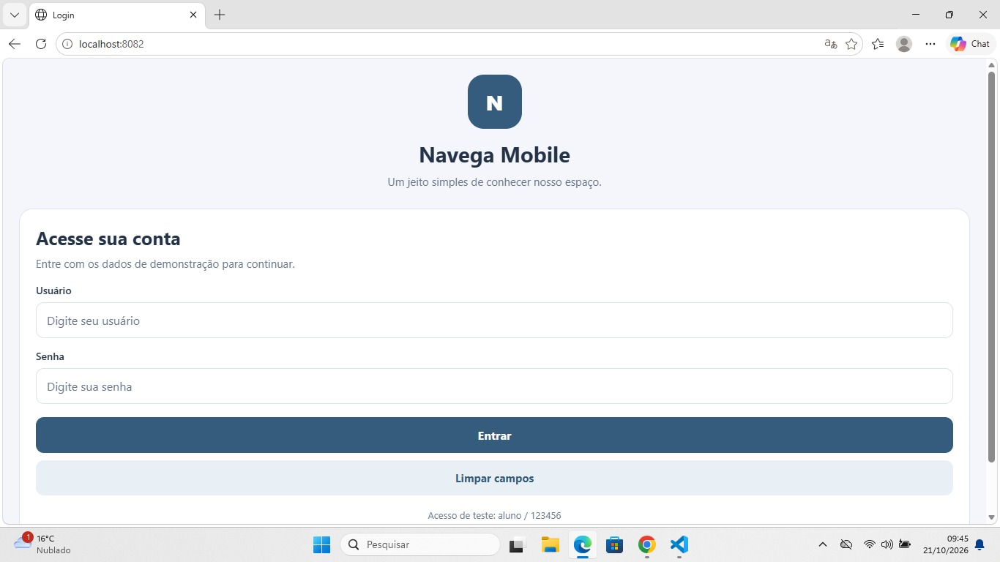
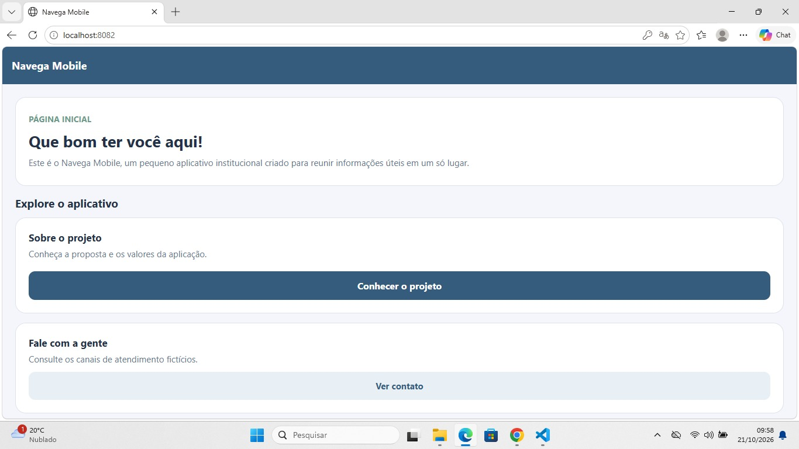
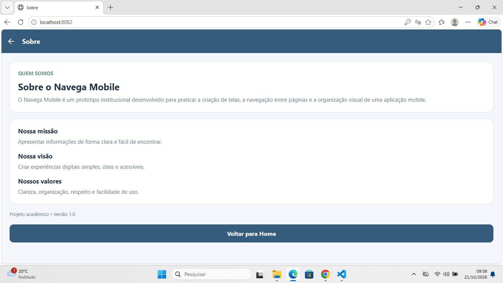
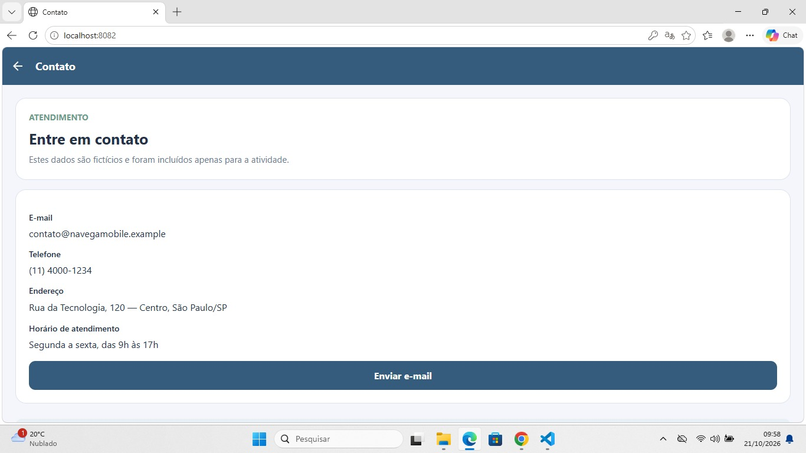

# Navega Mobile

**Aluna:** Maria Izabel Araujo  
**Versão:** 1.0

## Sobre o projeto
Aplicativo mobile demonstrativo com tela de login, Home, Sobre e Contato. O objetivo é praticar navegação entre telas, Toolbar, validação de campos e estilização com `StyleSheet`.

## Tecnologia
- React Native
- Expo
- React Navigation
- StyleSheet

## Como executar
1. Instale o Node.js e o Expo.
2. Abra a pasta do projeto no terminal.
3. Execute `npm install`.
4. Execute `npx expo start`.
5. Leia o QR Code com o aplicativo Expo Go ou use um emulador compatível.

## Credenciais de teste
- Usuário: `aluno`
- Senha: `123456`

O login é apenas uma simulação. Não utiliza banco de dados, API ou armazenamento persistente.

## Estrutura
- `App.js`: configuração de navegação e Toolbar.
- `src/pages/`: telas Login, Home, Sobre e Contato.
- `src/components/`: botão reutilizável.
- `src/styles/`: cores e estilos compartilhados.

## Funcionalidades
- Validação de usuário e senha.
- Mensagens para campos vazios e credenciais inválidas.
- Navegação entre Home, Sobre e Contato.
- Botão para limpar os campos do login.
- Estilos reutilizáveis definidos com `StyleSheet`.
- Ação para abrir o aplicativo de e-mail do dispositivo.

